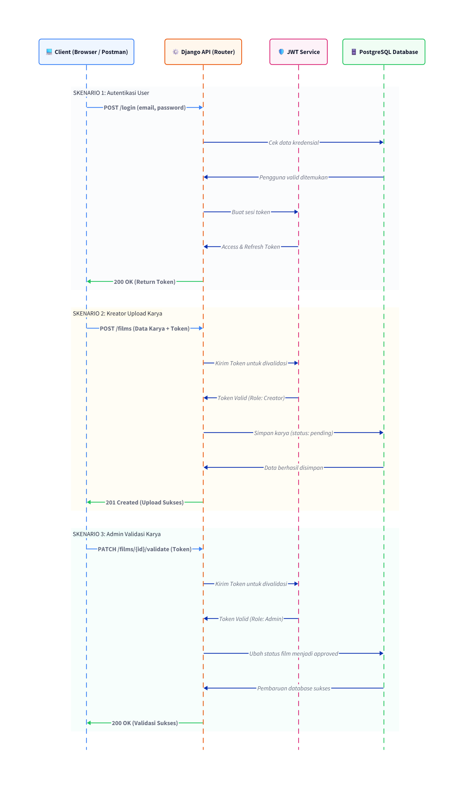
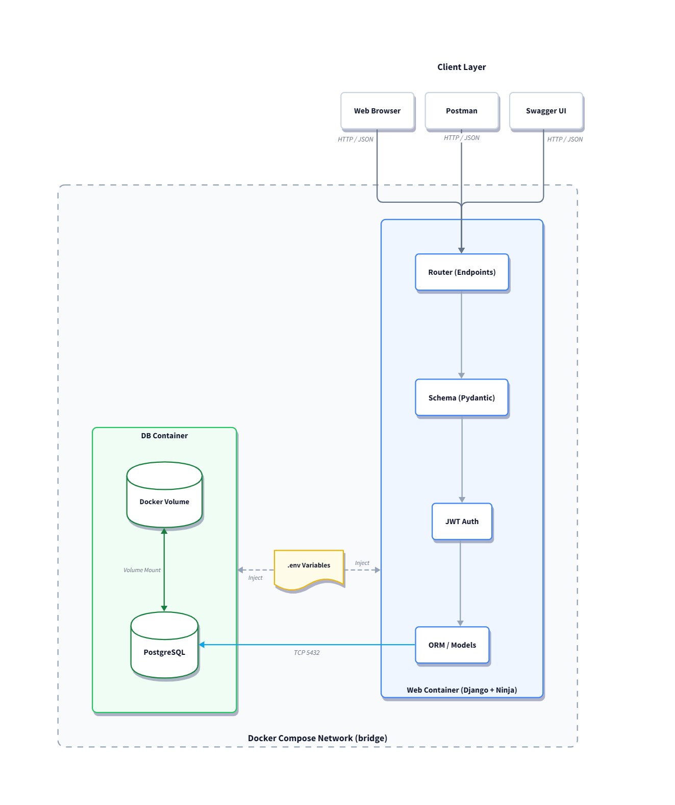

# PF Space - Galeri Digital & Arsip Karya Film SMKN 1 Ngasem

**PF Space** adalah platform galeri digital dan arsip karya berbasis web yang dirancang khusus untuk mewadahi, mengelola, dan mengapresiasi karya film serta dokumen produksi siswa Jurusan Produksi Film SMKN 1 Ngasem.

Backend dari platform ini berfungsi sebagai pusat data terpadu untuk mengamankan karya, mengatur hak akses, dan menyediakan fitur kolaboratif (seperti voting dan diskusi).

---

## 📌 1. Analisis Kasus & Solusi

### Latar Belakang
Jurusan Produksi Film SMKN 1 Ngasem dimulai pada tahun 2024 dan kini memiliki sekitar **102 siswa per angkatan**. Selama ini, karya siswa berupa film dan dokumen produksi (naskah, storyboard, RAB) masih disimpan sendiri-sendiri di harddisk, flashdisk, atau Google Drive pribadi.

Berdasarkan observasi dan wawancara sederhana terhadap siswa:
*   🔴 **$\pm 40\%$** siswa pernah kehilangan atau mengalami kerusakan file produksi.
*   🔴 **$\pm 65\%$** siswa menyimpan dokumen di tempat yang berbeda-beda sehingga sulit dicari dan dikelola.
*   🔴 **$\pm 60\%$** siswa menyatakan belum ada platform terpusat untuk memberi apresiasi, komentar, atau penilaian karya antar-angkatan.
*   🔴 **Masalah Guru & Adik Tingkat**: Guru harus membuka banyak file dan aplikasi saat evaluasi, serta siswa baru kesulitan belajar dari karya kakak tingkat.

### Solusi: PF Space
Galeri digital dan arsip karya berbasis web dengan Backend yang berfungsi sebagai:
1.  **Pusat data terpusat** untuk film dan dokumen produksi.
2.  **Pengatur hak akses (Authorization)** untuk keamanan dokumen sensitif (seperti RAB).
3.  **Media interaksi** dengan fitur voting dan diskusi untuk evaluasi serta apresiasi karya.

---

## 👥 2. Kebutuhan Pengguna

### Kebutuhan Fungsional

| Pengguna | Kebutuhan |
| :--- | :--- |
| **User (Siswa / Umum)** | Mendaftar dan login, melihat film yang sudah dipublikasikan, memberi vote, serta ikut dalam diskusi (komentar). |
| **Creator (Perwakilan Kelompok)** | Seluruh kebutuhan **User**, ditambah mengunggah (upload) dan menyunting (edit) film beserta dokumen produksinya (sinopsis, crew, naskah, storyboard, RAB, poster). |
| **Admin (Guru)** | Memvalidasi karya (`publish` atau `reject`), mengelola kategori film, serta mengelola data user dan role. |

### Kebutuhan Non-Fungsional (Analisis PIECES)
*   **Permanensi Data**: Data karya tersimpan permanen dan tidak hilang saat server dijalankan ulang (*persistent storage*).
*   **Keamanan (Security)**: Dokumen sensitif seperti RAB hanya dapat diakses oleh user yang memiliki hak akses sesuai perannya.
*   **Efisiensi**: Pencarian dan pengambilan data film berelasi berjalan cepat dan efisien.
*   **Integritas Data**: Satu user hanya dapat memberikan maksimal satu vote untuk satu film (*unique constraint*).

> **Catatan**: Fitur asisten AI dan evaluasi otomatis pada rancangan awal tidak dibangun pada fase ini dan dipersiapkan untuk pengembangan lanjutan.

---

## 🎯 3. Tujuan Backend
1.  **Integrasi Pusat Data**: Menjadi pusat data terintegrasi untuk film dan dokumen produksi siswa.
2.  **REST API**: Menyediakan endpoint REST API (CRUD dan data berelasi) lengkap dengan dokumentasi interaktif.
3.  **Keamanan Berlapis**: Mengamankan akses melalui autentikasi JWT (JSON Web Token) dan otorisasi berbasis role.
4.  **Workflow Validasi**: Menjalankan alur validasi karya secara transparan: `pending` $\rightarrow$ `published` / `rejected`.
5.  **Portabilitas**: Mudah dijalankan di perangkat mana pun secara konsisten menggunakan **Docker Compose**.

---

## 🔄 4. Alur Client-Server

Sistem ini menjalankan tiga skenario utama untuk otentikasi, pengunggahan karya oleh kreator, dan validasi oleh admin.

### Diagram Alur (Sequence Diagram)

### Penjelasan Alur:
*   🔑 **Skenario 1 (Login User)**
    1. Client mengirim email dan password ke API (`POST /login`).
    2. API mencocokkan data dengan PostgreSQL database.
    3. Jika cocok, API membuat access token & refresh token, lalu mengirimkannya ke client dengan respons `200 OK`.
    4. Jika data tidak valid, API membalas dengan `401 Unauthorized`.
*   📤 **Skenario 2 (Kreator Upload Karya)**
    1. Client mengirim data film beserta dokumen produksi dan access token (`POST /films`).
    2. API memeriksa validitas token dan memastikan peran pengguna adalah `Creator`.
    3. Film disimpan ke database dengan status awal `pending`, lalu API membalas `201 Created` (Upload Sukses).
*   ⚖️ **Skenario 3 (Admin Validasi Karya)**
    1. Client mengirim keputusan validasi (approve/reject) beserta access token (`PATCH /films/{id}/validate`).
    2. API memeriksa validitas token dan memastikan peran pengguna adalah `Admin`.
    3. Status film diubah menjadi `published` atau `rejected`. Jika ditolak, menyertakan alasan penolakan (`rejection_reason`). API membalas dengan `200 OK`.

> 🚫 *Request tanpa token atau token tidak valid ditolak dengan `401 Unauthorized`, sedangkan akses dari role yang tidak berhak ditolak dengan `403 Forbidden`.*

---

## 🏗️ 5. Architectural Pattern

### Pola: Layered Architecture (Multitier) & Modular Monolith
Aplikasi dibangun di atas framework **Django (dengan Django Ninja)** sebagai modular monolith dengan tiga lapisan:
1.  **Lapisan API (Presentation Layer)**: Router dan Schema (menggunakan Pydantic untuk validasi input).
2.  **Lapisan Keamanan & Logika (Business Logic Layer)**: Pengamanan via JWT, pengecekan otorisasi role, dan aturan workflow validasi film.
3.  **Lapisan Data (Data Access Layer)**: Object-Relational Mapping (ORM) / Models dan PostgreSQL.

### Alasan Pemilihan Arsitektur:
*   **Kesesuaian Skala**: Skala sistem bersifat lokal (satu sekolah, satu server) sehingga monolithic jauh lebih hemat resource dan mudah dikelola ketimbang microservices yang rumit.
*   **Pemisahan Tanggung Jawab (Separation of Concerns)**: Setiap lapis memiliki tanggung jawab yang jelas sehingga memudahkan pengujian (testing) dan perawatan (maintenance).
*   **Keamanan Terjamin**: JWT yang bersifat *stateless* sangat cocok untuk mengamankan REST API.
*   **Kemudahan Deployment**: Hanya membutuhkan dua container (web service & database) sehingga ringan dan cepat dijalankan lewat Docker Compose.

---

## 🌐 6. Diagram Arsitektur

Arsitektur aplikasi terisolasi dalam satu jaringan virtual berbasis kontainer untuk performa dan keamanan.

*   **Client Layer**: Web Browser, Postman, dan Swagger UI mengirim request HTTP/JSON ke kontainer web.
*   **Web Container (Django + Ninja)**: Memproses request secara berurutan: `Router (Endpoints)` $\rightarrow$ `Schema (Pydantic)` $\rightarrow$ `JWT Auth` $\rightarrow$ `ORM/Models`.
*   **DB Container (PostgreSQL)**: Terhubung dengan ORM pada Web Container via TCP port `5432`. Data database disimpan pada Docker Volume agar data tetap aman saat kontainer restart/rebuild.
*   **Konfigurasi**: Variabel sensitif disuntikkan dari file `.env` ke kedua kontainer yang berjalan dalam Docker Compose Network (bridge).

---

## 🗄️ 7. Rancangan Relasi Data (ERD)

Desain basis data relasional untuk mendukung integrasi karya, voting, dan diskusi interaktif.

> ⚠️ *Catatan Khusus: Pasangan (user_id, film_id) pada tabel **Votes** bersifat unik, memastikan satu user hanya dapat memberikan satu vote untuk satu film.*

### Detail Entitas & Atribut
*   👤 **Users**: `id` (PK), `name`, `email` (Unique), `password` (Hash), `role` (USER / CREATOR / ADMIN), `created_at`.
*   📁 **Categories**: `category_id` (PK), `name` (Unique), `slug`.
*   🎬 **Films**: `film_id` (PK), `user_id` (FK), `category_id` (FK), `judul`, `sinopsis`, `tahun_karya`, `link_video_utama`, `gambar_poster`, `file_naskah`, `file_storyboard`, `file_rab`, `status` (pending / published / rejected), `rejection_reason`, `created_at`.
*   🗳️ **Votes**: `vote_id` (PK), `user_id` (FK), `film_id` (FK), `created_at` *(Unique constraint pada kombinasi user_id & film_id)*.
*   💬 **Discussions**: `diskusi_id` (PK), `user_id` (FK), `film_id` (FK), `isi_pesan`, `parent_id` (FK ke Discussions untuk sistem reply), `created_at`.

### Relasi Antar Entitas:
*   **User 1 - N Film**: Satu user (dengan role `Creator`) dapat mengunggah banyak film.
*   **Category 1 - N Film**: Satu kategori dapat menaungi banyak film.
*   **User 1 - N Vote & Film 1 - N Vote**: `Votes` menghubungkan relasi Many-to-Many antara User dan Film dengan batasan unik.
*   **User 1 - N Discussion & Film 1 - N Discussion**: Satu film dapat memiliki banyak komentar dari berbagai user.
*   **Discussion 1 - N Discussion (Self-Relation)**: Hubungan rekursif via `parent_id` untuk memfasilitasi fitur balas-membalas komentar (reply thread).

---

## 🔒 8. Hak Akses Pengguna

| Aksi | User | Creator | Admin |
| :--- | :---: | :---: | :---: |
| **Lihat film published** | ☑️ | ☑️ | ☑️ |
| **Vote dan komentar** | ☑️ | ☑️ | ☑️ |
| **Upload film** | ❌ | ☑️ | ❌ |
| **Edit/hapus film** | ❌ | ☑️ *(Milik sendiri)* | ☑️ *(Semua)* |
| **Validasi (publish/reject)** | ❌ | ❌ | ☑️ |
| **Kelola kategori** | ❌ | ❌ | ☑️ |
| **Kelola user dan role** | ❌ | ❌ | ☑️ |

Role disimpan pada kolom `role` di tabel `Users` dan akan diverifikasi di sisi server (server-side authentication/authorization) pada setiap request endpoint yang diakses.